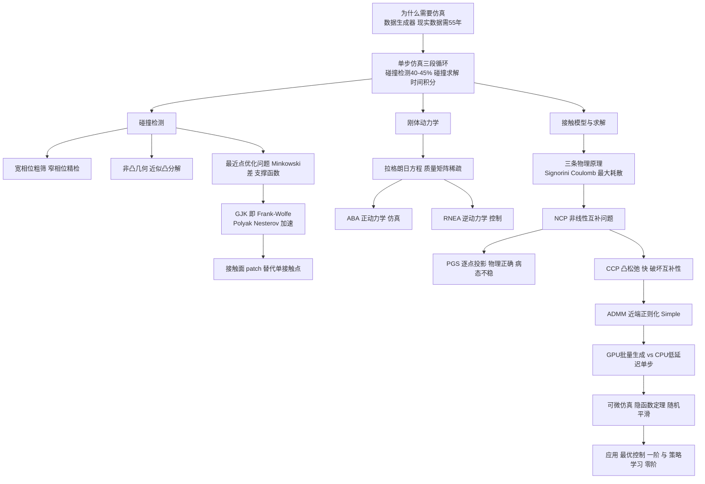

# 课程笔记｜MVA Robotics｜Simulation for Robotics（机器人仿真）

## 课程信息

| 项目 | 内容 |
|---|---|
| 日期 | 2026-10-15（周四） |
| 课程/章节 | MVA Robotics 3.1 Simulation for Robotics（主讲 Justin Carpentier，Inria WILLOW 团队负责人） |
| 使用材料 | 课件 simulation.pdf（141 页，正文约 76 页）；上半场智能纪要（lightwheel 链接，15:09–16:36）；下半场讨论录音纪要（16:55–18:02，本会话录音生成）；TP：2_simulation.ipynb + tp2/contact_dyn.py |
| 整理范围 | 完整。两段录音纪要均为 AI 生成，个别术语疑似误转写（见"待核对与疑问"） |

## 一、核心结论

1. 仿真的战略作用是当数据生成器：真实机器人采集等效训练数据需要约 55 年，而仿真把同样规模的数据压缩到几小时。DeXtreme 单次训练即约 1e11 次仿真调用、60 小时 x 16k 环境、约 1000 美元、55kg CO2（约等于开车 300km）。[课件 p.25；上半场纪要 16:04]
2. 仿真单步是一个三段循环：碰撞检测（collision detection，占单步算力 40–45%）→ 碰撞求解（collision resolution，按物理原理求接触力）→ 时间积分（time integration）。[课件 p.14–15；上半场纪要 24:12]
3. 碰撞检测的本质是优化问题：两凸体最近点 = 最小范数点问题（minimum norm point, MNP），用支撑函数（support function）隐式处理 Minkowski 差；GJK 是经典解法，Polyak/Nesterov 加速后可达微秒级（专用求解器约 2µs），满足 1kHz 实时控制。[课件 p.22–33；上半场纪要 31:16]
4. 接触力由三条物理原理约束：Signorini 互补条件、Coulomb 摩擦锥、Moreau 最大耗散原理；三者合起来构成非线性互补问题（NCP）。[课件 p.45–46；下半场纪要 27:21]
5. 求解 NCP 有两条典型路线：PGS 逐接触点投影（物理正确、无异常现象，但病态多接触场景不收敛、穿透、抖动）；CCP 凸松弛 + ADMM（快而稳，但破坏互补性，滑动时会出现非物理的"小弹跳"）。[课件 p.47–49；下半场纪要 45:00、52:34；TP]
6. 动力学侧：拉格朗日方程 M(q)q̈ + C(q,q̇) + G(q) = τ + Jcᵀλc；利用运动树的稀疏性，正向动力学用 ABA（Articulated Body Algorithm，仿真），逆动力学用 RNEA（Recursive Newton-Euler，控制），工程实现即 Pinocchio。[课件 p.41–42；上半场纪要 01:04:23]
7. 硬件分工：GPU 擅长大规模并行数据生成，单步低延迟仿真仍靠 CPU 算法优化；前沿方向是可微仿真（用隐函数定理求导），隐式梯度与仿真本身同量级（约 4–95µs），比有限差分（约 0.4e3–26.7e3µs）快约两个数量级。[课件 p.57、74]

## 二、知识结构

## 三、详细笔记

### 3.1 为什么需要仿真：数据生成器与两条控制路线

机器人控制的核心是在有限的"世界投影信息"上构建"决策-动作"闭环，把感知连接到电机空间（motor space），选择合适动作完成任务。[上半场纪要 00:00]

求解这个决策问题有两条路线：

- 最优控制（optimal control）+ 估计（estimation）：基于系统动力学模型，对初始假设高度敏感，假设错了就容易失败。
- 策略学习（policy learning）：数据驱动，从海量真实样本（多数来自难以建模的图像）中学习控制，覆盖多状态分布、泛化能力更强，但需要大量数据。

两条路线共同依赖一个事实：真实数据采集成本不可接受。DeXtreme 的例子给出量级：一次训练 60 小时 x 16k 环境 ≈ 1e11 次仿真调用 ≈ 55 年真实机器人运行时间，配套百万欧元级基础设施和高能耗。[课件 p.25；上半场纪要 16:04]

由此得到本讲的核心立场：模型永远有错，sim-to-real gap（仿真与现实差距）永远存在，正确的用法是"让策略在实验室里失败"——用与真实世界对齐良好的仿真器当数据生成器，把现实差距压到可接受范围；同时警惕域污染（domain contamination），不要过度依赖单一假设，善用问题结构而不是追求不可能的全覆盖。[上半场纪要 06:01；金句：It is crucial to have a good simulator, which is very aligned with reality... the model is always wrong.]

### 3.2 单步仿真三段循环

物理仿真的对象是带接触冲击的非光滑动力学。单步（time-stepping）流程是：

1. 碰撞检测：找到接触点（contact points）。
2. 碰撞求解：根据物理原理求出接触力/冲量 λ。
3. 时间积分：用半隐式欧拉更新状态（速度、位置）。

计算占比：碰撞检测约占总算力 40–45%，是最耗时的一步；求解与积分相对便宜。[课件 p.14–15、31；上半场纪要 24:12]

离散化形式（TP notebook）：M(qᵗ)νᵗ⁺¹ = M(qᵗ)νᵗ + (τᵗ − b(qᵗ,νᵗ))Δt + Jᵀλ，令自由速度 νf = νᵗ + M⁻¹(τᵗ − b)Δt，则 νᵗ⁺¹ = νf + M⁻¹Jᵀλ。接触点速度 c = Jνᵗ⁺¹ = Gλ + g，其中 G = JM⁻¹Jᵀ 称为 Delassus 矩阵（操作空间惯性矩阵的逆），g = Jνf 是零接触力下的接触点速度。[TP 2_simulation.ipynb]

### 3.3 碰撞检测

几何分类：mesh（网格）、non-convex、convex、strictly convex。[课件 p.20]

两阶段流水线：

- 宽相位（broad phase）：用包围盒（bounding box，OBB 等）快速剔除不可能碰撞的物体对，把 O(n²) 的对数检查降到候选对。[课件 p.18–19]
- 窄相位（narrow phase）：对候选对做精细几何验证，找真实接触点。[课件 p.19]

非凸几何处理：把原物体分解为凸子形状的集合。两个主要算法：VHACD（Mammou, ICIP 2009，简单高效）和 COACD（Wei et al., ACM TOG 2022，碰撞感知的凹度与树搜索）。[课件 p.21；上半场纪要 28:41]

最近点问题即优化问题：对两个凸体 A1、A2，求 argmin ½‖x1 − x2‖²。对网格（mesh）可写成带线性不等式约束的二次规划（QP）实例：A1x1 ≤ b1, A2x2 ≤ b2。[课件 p.22]

转化为最小范数点问题：Minkowski 差 D = A1 − A2 = {x1 − x2}。两体是否碰撞等价于原点 0 是否在 D 内（D 内 → 碰撞；D 外 → 有分离距离）。求最近距离等价于 min ½‖x‖², x ∈ D。[课件 p.25]

关键工具——支撑函数（support function）与支撑映射（support mapping）：σ_A(n) = min_{x∈A} xᵀn；支撑点 s ∈ ∂σ_A(n) = argmin xᵀn。对任意常见几何（球、盒、胶囊、网格凸包）可极高效计算。[课件 p.26；上半场纪要 42:16]

核心性质：Minkowski 差上的支撑函数可以逐物体分解：σ_D(n) = σ_A1(n) − σ_A2(−n)，且 s = s1 − s2 ∈ ∂σ_D(n)。因此不需要显式构造复杂的 Minkowski 差，用支撑查询即可。[课件 p.27；上半场纪要 42:16]

GJK 算法（Gilbert–Johnson–Keerthi, 1988）：本质上是 Frank-Wolfe（1956）算法求解最小范数点问题的特例；进一步可升级为 fully-corrective Frank-Wolfe（在第 k 步对已收集支撑点张成的凸包 conv(s0…sk) 上做子问题）。[课件 p.28–30]

加速 GJK（GJK++，Montaut et al., IEEE T-RO 2023）：引入 Polyak 步（加阻尼、低通滤波、抑制振荡）与 Nesterov 步（外推当前迭代点算梯度），两步即可实现，基准上整体快约 2 倍；对比库包括 HPP-FCL、FCL、Bullet 的 GJK。[课件 p.32–37、62–63] 上半场提到专用求解器把单次求解压到约 2µs，满足 1kHz 实时控制。[上半场纪要 31:16]

超越单接触点——接触面（contact patch）：只用单个接触点常常导致不合理、与真实无关的结果；从当前最优解出发提取接触 patch（接触面/接触区域）更可靠，且计算几乎免费。"More is better." [课件 p.38–39；上半场纪要 55:28]

### 3.4 刚体动力学：拉格朗日方程与高效算法

多关节（poly-articulated）系统动力学由拉格朗日（Joseph-Louis Lagrange）动力学描述：

M(q)q̈ + C(q,q̇) + G(q) = τ + Jcᵀ(q)λc

其中 M(q) 质量矩阵（正定、稀疏、对称），C 科氏/离心项，G 重力项，τ 电机力矩，Jcᵀλc 为接触/交互外力经 Jacobian 传递到系统的广义力。[课件 p.41；下半场纪要 06:07]

关节系统构成运动树（kinematic tree）甚至带闭合链的图；运动约束减少自由度，因此不需要为每个连杆单独写牛顿方程。[上半场纪要 57:46]

高效计算的两个函数：

- 正动力学（forward dynamics）q̈ = ForwardDynamics(q, q̇, τ, λc)：用于仿真。对应 Articulated Body Algorithm（ABA，Roy Featherstone），利用树的稀疏性，复杂度随深度而非全矩阵。
- 逆动力学（inverse dynamics）τ = InverseDynamics(q, q̇, q̈, λc)：用于控制。对应 Recursive Newton-Euler Algorithm（RNEA）。

1970s–80s 机器人学界的主要努力就是把动力学复杂度降下来，支撑工业机器人与仿人机器人的快速稳定控制回路；现代工程框架是 Pinocchio（github.com/stack-of-tasks/pinocchio）。[课件 p.42、43；上半场纪要 01:04:23]

### 3.5 接触模型与三条物理原理

接触模型谱系：[课件 p.44]

- 弹簧-阻尼模型（spring-damper model）：可变形接触（deformable contact），1980 年代视频游戏仿真常用，靠人工柔顺参数。
- 双边约束（bilateral）：刚性接触，不允许穿透也不允许分离。
- 单边约束（unilateral）：刚性接触，只约束"不穿透"，允许分离。
- 松弛接触（relaxed contact）：把互补性做松弛，物理上会引入伪现象。

三条第一性原理（first principles）：[课件 p.45]

1. Signorini 条件：0 ≤ λn ⊥ σn ≥ 0。法向接触力非负，且法向间隙非负，二者互补——要么接触（有力、无间隙），要么分离（无间隙、无力）。不允许"粘住"（gluing effect）。
2. Coulomb 摩擦约束：λ ∈ Kμ，即切向力 ‖λT‖ ≤ μλN（在摩擦锥内）；滑动前切向力不超过极限。
3. Moreau 最大耗散原理：λT ∈ argmax_{‖y‖≤μλn} −yᵀσt。滑动时摩擦力方向与切向速度相反、大小取摩擦极限，最大化耗散功率。

接触状态三分：breaking（脱离）、sticking（粘滞）、sliding（滑动）。[课件 p.45–46；下半场纪要 15:52]

把三条原理写在一起，接触问题成为非线性互补问题（Nonlinear Complementarity Problem, NCP）：Kμ ∋ λ ⊥ σ + Γμ(σ) ∈ K*μ，其中 σ = (G + R)λ + g，Γμ(σ) = (0, 0, μ‖σt‖)。这是一个公认"难"的问题，各仿真器都在物理真实、鲁棒性、效率之间做权衡。[课件 p.46；Simple RSS 2024 论文]

### 3.6 接触求解器：PGS 与 CCP/ADMM

PGS（Projected Gauss-Seidel，投影高斯-赛德尔）：

- 逐个接触点处理：先用法向投影（λN ← max(0, λN − cN/GNN)）满足 Signorini，再做切向投影（把 λT 投影回半径 μλN 的圆盘）满足 Coulomb；每更新一个接触点后重新计算所有接触，迭代直到全部满足。[TP 2_simulation.ipynb；下半场纪要 45:00]
- 性质：收敛慢但结果符合物理定律，不会出现异常非物理现象；对单接触场景精度足够。被 Bullet 等引擎采用。缺点是无收敛保证，多物体同时接触（高耦合）时可能不收敛，出现穿透、抖动。[课件 p.47 综述表；下半场纪要 52:34]

CCP（Conic Complementarity Problem）凸松弛：

- 把原 NCP 松弛成凸问题：min_{λ∈Kμ} ½λᵀGλ + gᵀλ（二阶锥约束二次规划），用 ADMM 迭代求解（λ-更新、SOC 投影 z、对偶变量 γ 更新）。MuJoCo 即走此路线（还额外引入柔顺接触）。[课件 p.47–48；TP]
- 代价：松弛破坏了 Signorini 互补条件，接触冲量可以在"分离"时仍出现，典型症状是物体在平面上滑动时出现非物理的小弹跳（bouncy effect）。"If you slide, you cannot — either you take off or you slide." [下半场纪要 27:21、52:34；课件 p.49]

Simple 的统一方法（Carpentier, Le Lidec, Montaut, RSS 2024；github.com/Simple-Robotics/Simple）：

- 用近端正则化（proximal regularization）处理纯刚体情形，不松弛互补性（区别于 CCP 的弹跳副作用）。
- 自适应谱更新（adaptive spectral update）近端参数 ρ：根据原始/对偶残差的比例调整（p ← p ± pinc/pdec，ρ = mL(m/L)^p），对病态问题鲁棒（物体质量差异巨大、接触数多）。
- 再叠加 Pinocchio 的高效刚体算法利用问题稀疏性。
- 基准：15 个方块堆叠、超过 60 个接触点、质量从 1kg 到 10000kg 的极端病态场景仍稳定求解。[课件 p.48–53、103]
- 综述对照见 Le Lidec et al., Contact Models in Robotics: a Comparative Analysis, IEEE T-RO 2024：对比 LCP-PGS、CCP-PGS/MuJoCo、NCP-PGS、Staggered projections、ADMM 等在 Signorini/Coulomb/收敛保证/鲁棒性上的差异。[课件 p.47、90]

适用性结论（下半场讨论）：单接触场景用 PGS 就够且准确；多接触复杂场景（如堆叠物体）PGS 易不收敛，应换 ADMM/CCP 一类方法。[下半场纪要 52:34]

### 3.7 GPU vs CPU：硬件分工

- GPU：适合大规模批量（massive batch）并行数据生成（RL 训练环境），"generate massively amount of data"。
- CPU：适合低延迟单步仿真；仿真本质是顺序且混沌的（sequential & chaotic），单步求解 GPU 未必更快。金句："What we can do with GPU is to generate massively amount of data. But if you want just one step, one step takes very long time." [课件 p.56–58；上半场纪要 01:10:40]
- 理想仿真器（MORE with LESS）：CPU 侧算法优化做低延迟单步 + GPU 侧批量数据生成。[课件 p.57–58]

### 3.8 可微仿真（differentiable simulation）

可微优化：对 x*(θ) = argmin f(x,θ)，用隐函数定理（implicit function theorem）计算 dx*/dθ = −[∇²xx f(x*,θ)]⁻¹ ∇²xθ f(x*,θ)，从而梯度可穿过优化问题的解传播。[课件 p.60]

为什么不用有限差分：把仿真当黑盒、加小扰动估计梯度，实现简单但低效、对舍入误差敏感。[课件 p.61]

接触动力学的难点：非光滑（non-smooth）。存在大量场景下标准非光滑物理模型给出的梯度无信息（例如接触与否切换处梯度为 0），经典光滑优化方法会失败。[课件 p.64]

两条可微路径：

- 随机平滑（randomized smoothing）：把 argmin 换成扰动期望 y*ε(θ) = E_Z[y*(θ+εZ)]，得到处处非零的梯度估计（Berthet et al., NeurIPS 2021）。[课件 p.65]
- 隐式微分 NCP：对 NCP 映射做隐式求导，∂λ*/∂θ 通过线性系统 G(∂λ*/∂θ) = ∂G/∂θ λ* + ∂g/∂θ 解出。[课件 p.72–73]

效率量级（课件基准，Half-cheetah/Humanoid/UR5/Go1/H1/Atlas，µs/次）：仿真本体 15.8/42.6/12.3/62.6/139.3/127.3；隐式梯度 14.7/47.9/4.1/93.0/54.3/95.2（与仿真同量级）；有限差分 1.1e3/5.5e3/0.4e3/6.6e3/17.6e3/26.7e3。整体比 Nimble Physics、Dojo 等替代方案快可达 100 倍。[课件 p.74、138]

连接最优控制与强化学习：最优控制用一阶方法（梯度来自可微仿真器）；策略学习用零阶方法（RL，靠样本）。同一个仿真器支撑两条路线。[课件 p.66]

应用案例：优化初始速度（如击打/投掷）、优化控制力矩轨迹。[课件 p.75、139–140]

## 四、例题、案例或实验

TP（2_simulation.ipynb，基于 Coal 碰撞库 + Pinocchio 积分）：

- 单立方体落地：cube 0.2m、1kg、μ=0.5，dt=1ms，仿真 1s。PGS 与 ADMM-CCP 都能正常落地静止。[TP]
- 立方体滑动（施加 x 方向过大水平力）：对比两求解器的 Signorini 约束残差——PGS 残差保持近 0，CCP 在滑动阶段出现明显互补性违反（对应弹跳伪现象）；同时对比 x/z 速度与位置曲线。[TP]
- 双立方体堆叠（病态）：下块 1e-3 kg、上块 1e3 kg（质量比 1e6），μ=0.9。PGS 因 Delassus 矩阵病态而不收敛，物体互相穿透、抖动；ADMM-CCP 稳定无穿透。与课件中 15 块堆叠（1kg–10000kg）的动机一致。[TP；课件 p.103]

课件基准：

- GJK++：在 YCB 与 ShapeNet 上生成数百万随机碰撞对，测距离计算与布尔碰撞检查，加速约 2x。[课件 p.35–37、64–66]
- Simple：堆叠 15 块、>60 接触点、质量 1–10000kg 的病态场景。[课件 p.103]
- 可微仿真：6 个机器人（Half-cheetah、Humanoid、UR5、Go1、H1、Atlas）的正向仿真/隐式梯度/有限差分耗时对比。[课件 p.137–138]

## 五、术语、公式或关键表达

| 术语（中文） | 英文 | 一句话解释 |
|---|---|---|
| 碰撞检测 | collision detection | 找出场景中正在碰撞的物体对并定位接触点 |
| 宽相位 / 窄相位 | broad phase / narrow phase | 包围盒粗筛候选对 / 精细几何验证 |
| 支撑函数 | support function | σ_A(n) = min_{x∈A} xᵀn，方向 n 上的最小投影 |
| Minkowski 差 | Minkowski difference | D = A1 − A2，碰撞判定化为原点是否在 D 内 |
| 最小范数点问题 | minimum norm point (MNP) | 求凸集内离原点最近的点，碰撞检测的核心子问题 |
| Delassus 矩阵 | Delassus matrix | G = JM⁻¹Jᵀ，接触点速度对接触力的线性映射 |
| 互补问题 | complementarity problem | 变量对 (λ, σ) 满足"二者至少其一为 0"的约束体系（NCP/LCP/CCP） |
| 摩擦锥 | friction cone | 允许接触力的锥形区域，‖λT‖ ≤ μλN |
| 投影高斯-赛德尔 | Projected Gauss-Seidel (PGS) | 逐接触点迭代投影求解互补问题 |
| 交替方向乘子法 | Alternating Direction Method of Multipliers (ADMM) | 分裂变量 + 近端项的优化算法，Simple 用它解 NCP |
| 近端正则化 | proximal regularization | 在更新中加入近端项以处理纯刚体情形 |
| 隐函数定理 | implicit function theorem | 由最优性条件求 argmin 解的导数 |
| 仿真与现实差距 | sim-to-real gap | 仿真模型与真实物理之间的偏差，模型永远有错 |
| 时间积分 | time integration | 由速度/加速度更新位置与速度的半隐式欧拉步 |

关键公式（符号说明）：

- 拉格朗日动力学 M(q)q̈ + C(q,q̇) + G(q) = τ + Jcᵀλc。M 质量矩阵（正定、稀疏、对称），C 科氏/离心，G 重力，τ 关节力矩，λc 接触力，Jc 接触 Jacobian（把关节速度映射到接触点速度、其转置把接触力传到广义坐标）。
- 离散化 νᵗ⁺¹ = νf + M⁻¹Jᵀλ，νf = νᵗ + M⁻¹(τᵗ − b)Δt（自由速度，无接触时的解）。
- 接触速度线性关系 c = Gλ + g，G = JM⁻¹Jᵀ。
- 三条原理：0 ≤ λn ⊥ σn ≥ 0（Signorini）；λ ∈ Kμ（Coulomb）；λT ∈ argmax −yᵀσt（Moreau 最大耗散）。
- NCP 表达：Kμ ∋ λ ⊥ σ + Γμ(σ) ∈ K*μ，σ = (G + R)λ + g。
- 隐函数求导：dx*/dθ = −[∇²xx f]⁻¹ ∇²xθ f。

## 六、课堂任务与 DDL

- 课程考核：本课程最终成绩由最后一次 quiz 加期末项目（final project）构成。[下半场纪要 01:05:50]
- 本周情况：大学（含 E&S 楼、老教学楼、体育馆、超市）整周关闭，本周课程取消；课程内容暂未上传到网站。[下半场纪要 45:00]
- 具体截止日期（deadline）未在材料中明确；以上为课堂上明确的考核口径，其余待课程恢复后确认。

## 七、待核对与疑问

| 问题 | 原因 | 建议核对方式 |
|---|---|---|
| 下半场纪要中反复出现 "CCTV relaxation / CCTV solutions" | AI 转写疑似误写；结合 TP 文件名（ADMM_dualCCP.png、PGS_NCP.png）与课件，应为 CCP（conic complementarity problem） | 回听录音原文或对照文字记录链接核对 |
| 上半场纪要 12:52 提到 "developed by Mark Rother's team" | 人名疑似转写有误（可能是 Marc Raibert / MIT Cheetah 相关工作），"像电子游戏一样接收参考速度、靠传感器自平衡"的演示 | 对照妙记文字记录核对人名与出处 |
| 上半场纪要 28:41 出现 "most attendees are following Alexander's condition" | 语义不明，疑似误转写（可能与凸分解算法条件相关） | 对照文字记录原文 |
| 碰撞检测占算力 40–45% | 纪要给出数字，课件 p.15 为计算成本图但文本层未直接印出百分比 | 查看课件 p.15 图与完整文字记录 |
| 专用求解器 2µs | 上半场纪要 31:16 口头说明；课件基准图单位为 µs | 核对 GJK++ 论文基准表 |

## 八、复习与主动回忆

### 10–20 分钟复习清单

1. 用一段话复述"仿真为什么是数据生成器"，带上 55 年、1e11、DeXtreme 三个量级。
2. 在白纸上画三段循环，标出各段职责和碰撞检测的算力占比。
3. 复述碰撞检测的转化链：QP/MNP → Minkowski 差 → 支撑函数 → GJK（Frank-Wolfe）→ 加速。
4. 写出拉格朗日方程，并说明每一项的含义；说出 ABA 与 RNEA 各自服务仿真还是控制。
5. 默写三条接触物理原理的数学表达，说明它们为什么合起来是 NCP。
6. 对比 PGS 与 CCP 的取舍，并指出 TP 里两个实验分别验证了什么。
7. 用自己的话说清 GPU 与 CPU 在仿真中的分工，以及可微仿真为什么用隐函数定理而不是有限差分。
8. 复习 TP 代码：PGS 的法向/切向投影公式，ADMM 的 λ/z/γ 三步更新。

### 主动回忆题

1. 为什么说"模型永远是错的"，那仿真的正确用法是什么？[答案要点：sim-to-real gap 永远存在；正确用法是让策略在实验室失败、用对齐良好的仿真器生成数据、把 gap 压小；警惕域污染与单一假设]
2. 单步仿真为什么碰撞检测最贵？宽相位和窄相位各自做什么？[答案要点：占 40–45%；宽相位用包围盒粗筛候选对，窄相位对候选对做精确几何验证找接触点]
3. GJK 为什么不需要显式构造 Minkowski 差？[答案要点：支撑函数性质 σ_D(n) = σ_A1(n) − σ_A2(−n)，s = s1 − s2 ∈ ∂σ_D(n)，支撑查询即可驱动迭代]
4. Signorini 条件"0 ≤ λn ⊥ σn ≥ 0"物理上禁止什么？CCP 松弛为什么会违反它？[答案要点：禁止分离时有力（粘住）和接触时无力（穿透）；松弛后接触冲量可在分离状态出现，滑动时产生小弹跳]
5. 为什么质量比悬殊（如 1e3kg 与 1e-3kg 堆叠）会让 PGS 失效而 ADMM 可行？[答案要点：Delassus 矩阵病态，PGS 逐点投影收敛慢/不收敛导致穿透抖动；ADMM 有近端正则化与自适应谱参数 ρ，对病态鲁棒]
6. 可微仿真求梯度为什么不用有限差分？隐式梯度如何获得？[答案要点：有限差分低效且舍入敏感；用隐函数定理在最优性条件上求 dx*/dθ = −[∇²xx f]⁻¹∇²xθ f，或对 NCP 隐式微分]
7. GPU 在仿真里的适用边界是什么？[答案要点：GPU 适合大规模批量数据生成；单步低延迟（顺序且混沌）仍靠 CPU 算法优化]
8. 最优控制与策略学习在"用仿真器"这件事上的差别？[答案要点：最优控制用一阶方法（可微仿真器提供梯度）；策略学习用零阶方法（RL 采样），数据由仿真批量生成]

## 参考资料

- 课件：Simulation for Robotics, Justin Carpentier（MVA Robotics, 2026-10-15）
- 上半场纪要：智能纪要｜Robotics 3.1 Simulation（lightwheel.feishu.cn/docx/NyPOdMikVo6ai7xNdsOcLnWrnXf），妙记 lightwheel.feishu.cn/minutes/obcnmva9jepd9z541vw2rrxr
- 下半场纪要：智能纪要｜Robot Simulation Discussion（feishu.doubao.com/docx/T7sNdasqioEqeaxfQHucFODvnSM）
- TP：2_simulation.ipynb、tp2/contact_dyn.py（2026_MVA_Robotics_Exercises）
- Handa et al., DeXtreme: Transfer of Agile In-hand Manipulation from Simulation to Reality（课件 p.25 引用）
- Montaut, Le Lidec, Petrik, Sivic, Carpentier, GJK++: Leveraging Acceleration Methods for Faster Collision Detection, IEEE T-RO 2023
- Le Lidec, Jallet, Montaut, Laptev, Schmid, Carpentier, Contact Models in Robotics: a Comparative Analysis, IEEE T-RO 2024（arXiv:2304.06372）
- Carpentier, Le Lidec, Montaut, From Compliant to Rigid Contact Simulation: a Unified and Efficient Approach, RSS 2024（github.com/Simple-Robotics/Simple）
- Blondel & Roulet, The Elements of Differentiable Programming（arXiv:2403.14606）
